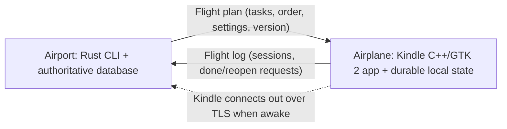

# pomo-kndl

Status: first build. The CLI, sync engine, and Kindle app run and are tested on macOS. Not yet cross-compiled or run on the Kindle.

A quiet Kindle focus timer driven by a portable Rust CLI. The computer is the airport: it holds the authoritative state and runs operations. The Kindle is the airplane: it departs with a flight plan, works on its own while disconnected, and lands with a flight log that the computer reconciles.

## Direction

- `pomo-kndl` (Rust) is the main CLI, the database owner, and the sync engine. Develop and install on this Mac first; macOS, Linux, and Windows are portability targets to verify.
- The Kindle runs a native C++ and GTK 2 application, launched through KUAL on a jailbroken device. It is the visual interface for tasks, timer, break, and completion.
- The computer is the head of operations. The Kindle carries what it needs, keeps working offline, and reports back.
- Local work needs no internet. Each device saves its own changes durably before reporting success.

## Quick start

```sh
# Computer (Rust 1.80+)
cd cli && cargo build --release
./target/release/pomo-kndl add "Write project outline"
./target/release/pomo-kndl pair --host <this-computer-LAN-ip>   # writes pairing.json
./target/release/pomo-kndl serve                                 # foreground TLS listener, port 7419

# Kindle app on the host, for development (needs openssl@3, and gtk+ 2 for the GUI)
cd kindle && make test dev gui
POMO_KNDL_DIR=/path/with/pairing.json ./build/pomo-kndl-gui

# End-to-end check: real Rust server + C++ client over pinned TLS
./tests/e2e.sh
```

Kindle install (not yet verified on device): cross-compile with an armhf Kindle toolchain (`make -C kindle package CROSS=... SYSROOT=...`), copy `dist/pomo-kndl/` to `/mnt/us/extensions/`, add `pairing.json` to that folder over USB, then open pomo-kndl from KUAL. The device must provide or bundle GTK 2 and OpenSSL libraries (`lib/` in the extension folder is on the library path).

The wire format is in [PROTOCOL.md](PROTOCOL.md).

## Layout

- `cli/` Rust CLI: SQLite database, landing engine, TLS `serve`, `pair`.
- `kindle/src/core.*` C++ state, flight log, timer, atomic saves. No GTK or network.
- `kindle/src/net.*` pinned TLS client (OpenSSL).
- `kindle/src/gui_main.cpp` GTK 2 UI. `dev_main.cpp` headless driver used by tests and the KUAL "Sync now" item.
- `kindle/kual/` KUAL extension files.
- `tests/e2e.sh` end-to-end sync test.

## Minimal Kindle UI

Two views: a short task list and the current session. Black and white, large readable type, generous touch targets, no animations, charts, or decorative panels. A small `pomo-kndl` wordmark is enough branding for the first version.

```text
pomo-kndl                      offline

Write project outline

              24 min
               focus

        [ Pause ]   [ End ]

Today: 2 sessions · 48 min
```

Show only actions relevant to the current state. Selecting a task offers Start; an active session offers Pause and End; the end screen offers Done, Continue later, and Break. Completed tasks appear crossed off until the next landing; archived tasks are not carried. Tasks awaiting computer review show a small "review" marker. A Sync button triggers a manual connection. Finishing a timer does not automatically complete a task.

Use a minute-level countdown and redraw only changed regions with e-ink-appropriate refresh modes. At expiry, transition visibly to the end screen. Default sessions are 25 minutes with an optional five-minute break; durations are configured through the CLI. Sleep, refresh, touch handling, and battery use need measurement on the actual device.

## Computer workflow

Commands are implemented. Task IDs accept any unique prefix. Task entry, edits, ordering, archiving, and settings belong in the CLI.

```sh
pomo-kndl add "Write project outline"
pomo-kndl edit <task-id> "New title"
pomo-kndl move <task-id> <position>
pomo-kndl tasks
pomo-kndl done <task-id>
pomo-kndl reopen <task-id>
pomo-kndl archive <task-id>
pomo-kndl config --focus 25 --break 5
pomo-kndl history
pomo-kndl status
pomo-kndl resolve <task-id> --kindle|--keep
pomo-kndl plan
pomo-kndl pair
pomo-kndl serve
```

Task entry, edits, ordering, archiving, and settings belong in the CLI. History shows completed tasks, actual focus minutes, and sessions per task. `status` shows the last landing, the plan version the Kindle carries, unreviewed log entries, and items awaiting `resolve`.

`serve` runs an explicitly started foreground sync listener. All other commands work against the local database without the Kindle. No background service installation is required for the first version.

## Flight plan, flight log, landing



One paired computer and one Kindle are the initial scope.

- **Flight plan** (computer to Kindle): every open task, its order, current settings, and a plan version. The Kindle treats it as read-only.
- **Flight log** (Kindle to computer): append-only entries for sessions, pauses, breaks, and done/reopen requests. Each entry has a unique ID and a per-device sequence number, and records the plan version it was made against.
- **Landing** (reconnect): the Kindle sends unacknowledged log entries, the computer applies them idempotently and acknowledges only durable writes, then sends a fresh plan. The Kindle drops acknowledged entries and swaps in the new plan atomically. Interrupted landings retry safely without duplicates.

Authority rules on landing:

1. Recorded sessions are facts and are always accepted.
2. A done/reopen request is applied if the computer has not changed that task since the plan version the Kindle carried.
3. Otherwise (the task was edited, archived, or its completion changed on the computer) the request is flagged in `status` and settled with `resolve`. The computer's state stands until then.

Device wall-clock time never decides ordering. Without the computer, the Kindle can select carried tasks, run sessions and breaks, and request completion. Neither device sees the other's new work until landing.

## Connection and security

- The computer runs `serve` and listens on the local network. The Kindle connects out as a client when awake, on demand and with bounded retries and backoff. No constant polling.
- TLS is required for all Wi-Fi sync. Pairing exchanges and pins each side's identity (certificate or public key fingerprint). Credentials are stored outside the repository in per-user application storage.
- A small versioned protocol shared by Rust and C++ carries only validated task/session operations, never arbitrary commands or filesystem paths.
- Wi-Fi availability after Kindle wake must be measured; sync only happens while the device is awake.

## Timer and tracking rules

All timers run on the Kindle for the first version. The computer plans and reviews work; computer-side timers and remote timer controls are deferred. This keeps one session owner and avoids competing timers while disconnected.

Persist the task ID, title at session start, planned duration, phase, and active focus intervals. Exclude pauses and breaks from focused time. Completed, interrupted, and cancelled sessions remain distinguishable. Settings changes apply from the next session, never to a running one.

Compute elapsed time from a monotonic clock while running, and persist enough state to recover after sleep or restart. Verify which clocks continue through Kindle suspend. Never turn uncertain downtime into confirmed focus time: request confirmation after ambiguous recovery. Reconcile a due timer on resume even if the screen could not update while asleep.

"Today" groups by the Kindle's local date for display only. The computer records clock offset at each landing and may regroup history; it never reorders log entries by timestamp.

## Implementation boundary

- **Computer:** one Rust executable, SQLite database, CLI commands, and the foreground TLS sync listener. Choose dependencies when implementing.
- **Kindle:** one native C++17 and GTK 2 executable, cross-compiled for the Paperwhite 5 (confirm the ARM target and ABI), launched via KUAL. Durable state uses atomic writes (write, fsync, rename) or bundled SQLite. TLS uses a library that cross-compiles cleanly (for example OpenSSL or mbedTLS). Handle suspend/resume through the device's system events (verify).
- Keep application data in per-user application storage, separate from source files.
- No firmware changes and no persistent device daemon are planned.

Earlier read-only inspection identified a Paperwhite 5 Signature Edition, firmware 5.18.5.0.1, with KUAL installed. The device has not been modified for this project.

## Build order and acceptance checks

1. **Kindle proof:** cross-compile toolchain, a GTK 2 window launched from KUAL, touch input, partial refresh, sleep/resume timing, Wi-Fi after wake, a pinned TLS connection to the Mac, and battery measurement.
2. **Local CLI:** add/edit/move/archive/complete tasks, settings, history. Verify persistence after restart and task identity across edits.
3. **Offline Kindle workflow:** a complete focus/break cycle with the computer off, pause accounting, explicit completion requests, and recovery from interrupted writes.
4. **Sync:** flight plan, flight log, landing. Verify reconnect, repeated delivery, interrupted transfer, the three authority rules, and history without duplicates.
5. **Install** the CLI on this Mac and document use. Check other operating systems before claiming support.

## Deferred scope

Desktop GUI, cloud accounts, multiple paired computers, multiple Kindles, phone app, computer-side timers, remote timer controls, token dashboards, external task integrations, elaborate branding, and USB file-based sync. USB may be used for initial deployment or pairing if the hardware proof supports it.
