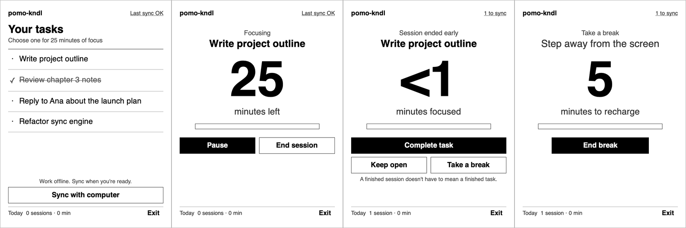
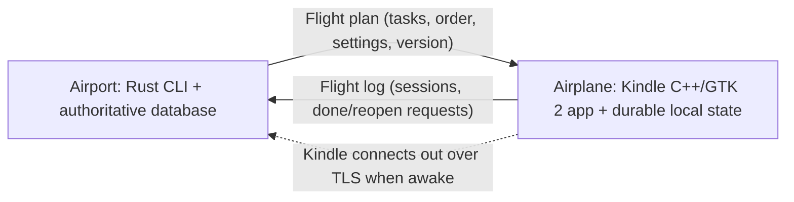

# pomo-kndl

A quiet Kindle focus timer driven by a portable Rust CLI. The computer is the airport: it holds the authoritative state and runs operations. The Kindle is the airplane: it departs with a flight plan, works on its own while disconnected, and lands with a flight log that the computer reconciles.



## Status (24 October 2026)

Working end to end on a Paperwhite 5 Signature Edition (firmware 5.18.5.0.1, KOReader v2026.03, KUAL): the GTK 2 app launches from KUAL, runs the timer offline, and syncs with this Mac over pinned TLS.

| Area | State | Evidence |
| --- | --- | --- |
| Rust CLI and database | Done | 15 unit tests, concurrent-writer check |
| Sync engine (plan, log, landing, authority rules) | Done | unit tests, `tests/e2e.sh` |
| Pinned TLS + pairing | Done | e2e: wrong pin and bad token refused |
| Kindle core (state, timer, crash/reboot recovery) | Done | 7 C++ tests with a fake clock |
| Kindle cross build | Done | `kindle/cross.sh`, `tests/kindle-vm.sh` (ARM VM, glibc 2.19) |
| Kindle GTK 2 UI | Updated package installed; new on-device launch check pending | native GTK workflow/layout checks, ARM VM sync, and installed-file checksum verification; screenshots in `docs/screens/` |
| Install on Mac as a command | Not yet | run from `cli/target/release` |
| Linux and Windows CLI | Not checked | |
| Sleep/resume, Wi-Fi after wake, battery, e-ink refresh tuning | Not measured | needs on-device sessions |

Known limits: `serve` handles one connection at a time (fine for one Kindle). The Kindle app needs KOReader installed for its TLS library. A reboot during focus pauses the session instead of counting the unknown gap.

Installation update, 24 October 2026 at 22:03 UTC: cross-built source revision `5323558` on the Mac and installed the ARM binaries plus KUAL launcher/config on the physical Kindle. All six installed files matched the build, and every other existing extension file, including pairing and task state, matched the pre-install backup. The Kindle was safely ejected. Rollback backup: `~/Library/Application Support/pomo-kndl/backups/20261024-NjYqvg/`. Open **KUAL > pomo-kndl > Open pomo-kndl** to check the new build on-device; installation verification is not a claim that the updated UI has already run on the physical screen.

## Direction

- `pomo-kndl` (Rust) is the main CLI, the database owner, and the sync engine. Develop and install on this Mac first; macOS, Linux, and Windows are portability targets to verify.
- The Kindle runs a native C++ and GTK 2 application, launched through KUAL on a jailbroken device. It is the visual interface for tasks, timer, break, and completion.
- The computer is the head of operations. The Kindle carries what it needs, keeps working offline, and reports back.
- Local work needs no internet. Each device saves its own changes durably before reporting success.

## Quick start

```sh
# Computer (Rust 1.80+)
cd cli && cargo build --release
./target/release/pomo-kndl add "Write project outline"
./target/release/pomo-kndl pair --host <this-computer-LAN-ip>   # writes pairing.json
./target/release/pomo-kndl serve                                 # foreground TLS listener, port 7419

# Kindle app on the host, for development (needs openssl@3, and gtk+ 2 for the GUI)
cd kindle && make test dev gui
POMO_KNDL_DIR=/path/with/pairing.json POMO_KNDL_GEOMETRY=618x824 ./build/pomo-kndl-gui

# Tests
./tests/e2e.sh          # real Rust server + C++ client over pinned TLS
./tests/kindle-vm.sh    # cross-built ARM binary in an ARM VM (needs nix for qemu)
make -C kindle net-test # TCP deadlines, stalled TLS, pinned exchange and wrong-pin rejection
bash tests/ui.sh       # real GTK callbacks, layouts and GUI-to-server sync; needs desktop GTK 2
bash tests/ui.sh docs/screens  # regenerate screenshots (ImageMagick adds overview.png)
```

Kindle install: with the Kindle mounted over USB, run `kindle/cross.sh`. It cross-compiles armhf binaries with clang and lld against a Debian sysroot (glibc 2.19, GLib/GTK headers from Debian 7), links the firmware's GTK 2 dynamically, and uses KOReader's LibreSSL at run time. Copy `kindle/dist/pomo-kndl/` to `/mnt/us/extensions/`, write `pairing.json` there with `pomo-kndl pair --host <ip> --out /Volumes/Kindle/extensions/pomo-kndl/pairing.json`, eject, and open pomo-kndl from KUAL.

KUAL menu: Open, Close, Sync now (headless), Diagnose (writes `diagnose.txt`), GTK probe (5 s test window). Logs go to `extensions/pomo-kndl/pomo-kndl.log`.

Screenshots are generated, not hand-made: `POMO_KNDL_SCRIPT="shot:list.png;tap:<task>;shot:focus.png"` dispatches GTK button events and writes PNGs (desktop preview only). The test script also supports `key:<target>` (Enter activation), `expect:<visible text>`, `absent:<visible text>`, `wait-sync` and `fit`. Set `POMO_KNDL_AUTO_SYNC=1` to exercise normal launch sync during a scripted preview. Missing targets, failed screenshots, and content extending outside its container fail the process rather than silently passing. Tests use isolated data and never change the real Kindle pairing or task log.

The wire format is in [PROTOCOL.md](PROTOCOL.md).

## Layout

- `cli/` Rust CLI: SQLite database, landing engine, TLS `serve`, `pair`.
- `kindle/src/core.*` C++ state, flight log, timer, atomic saves. No GTK or network.
- `kindle/src/net.*` pinned TLS client (OpenSSL).
- `kindle/src/gui_main.cpp` GTK 2 UI. `dev_main.cpp` headless driver used by tests and the KUAL "Sync now" item.
- `kindle/kual/` KUAL extension files. `kindle/cross.sh` device build.
- `tests/e2e.sh` end-to-end sync test. `tests/kindle-vm.sh` ARM VM test.
- `docs/screens/` UI screenshots at Paperwhite 5 proportions.

## Minimal Kindle UI

Two main views: a short task list and the current session. A connection-details view is available from the underlined status in either screen. Black and white, large readable type, generous touch targets, no animations, charts, or decorative panels.

The list shows five tasks per page with Previous/Next controls, so every carried task remains available offline. Long row titles are ellipsized without displacing the Review marker; the session view shows the full title at a size that leaves room for all actions. The session screen shows a minute countdown, a 20-step progress bar, and only the actions that apply: Pause/End session while focusing, Resume/End session while paused, Complete task/Keep open/Take a break at the end, End break during a break. The primary action is filled black. Exit is always in the footer; the timer keeps running while the app is closed.

Completed tasks appear crossed off until the next landing; tap one to reopen it. Archived tasks are not carried. Tasks awaiting computer review show a Review marker. Finishing a timer does not automatically complete a task.

The UI skips redraws when its displayed state is unchanged, but currently rebuilds the view when it changes. Region-only refresh and e-ink refresh-mode tuning remain unimplemented. At expiry, transition visibly to the end screen. Default sessions are 25 minutes with an optional five-minute break; durations are configured through the CLI. Sleep, refresh, touch handling, and battery use need measurement on the actual device.

## Computer workflow

Commands are implemented. Task IDs accept any unique prefix. Task entry, edits, ordering, archiving, and settings belong in the CLI.

```sh
pomo-kndl add "Write project outline"
pomo-kndl edit <task-id> "New title"
pomo-kndl move <task-id> <position>
pomo-kndl tasks
pomo-kndl done <task-id>
pomo-kndl reopen <task-id>
pomo-kndl archive <task-id>
pomo-kndl config --focus 25 --break 5
pomo-kndl history
pomo-kndl status
pomo-kndl resolve <task-id> --kindle|--keep
pomo-kndl plan
pomo-kndl pair
pomo-kndl serve
```

History shows completed tasks, actual focus minutes, and sessions per task. `status` shows the last landing, the plan version the Kindle carries, unreviewed log entries, and items awaiting `resolve`.

`serve` runs an explicitly started foreground sync listener. All other commands work against the local database without the Kindle. No background service installation is required for the first version.

## Flight plan, flight log, landing



One paired computer and one Kindle are the initial scope.

- **Flight plan** (computer to Kindle): every open task, its order, current settings, and a plan version. The Kindle treats it as read-only.
- **Flight log** (Kindle to computer): append-only entries for sessions, pauses, breaks, and done/reopen requests. Each entry has a unique ID and a per-device sequence number, and records the plan version it was made against.
- **Landing** (reconnect): the Kindle sends unacknowledged log entries, the computer applies them idempotently and acknowledges only durable writes, then sends a fresh plan. The Kindle drops acknowledged entries and swaps in the new plan atomically. Interrupted landings retry safely without duplicates.

Authority rules on landing:

1. Recorded sessions are facts and are always accepted.
2. A done/reopen request is applied if the computer has not changed that task since the plan version the Kindle carried.
3. Otherwise (the task was edited, archived, or its completion changed on the computer) the request is flagged in `status` and settled with `resolve`. The computer's state stands until then.

Device wall-clock time never decides ordering. Without the computer, the Kindle can select carried tasks, run sessions and breaks, and request completion. Neither device sees the other's new work until landing.

## Connection and security

- The computer runs `serve` and listens on the local network. The Kindle makes one attempt each time the GUI opens, including when its outgoing log is empty, and on manual Sync. No constant polling, automatic retry/backoff, or wake-triggered sync is implemented.
- TLS is required for all Wi-Fi sync. The Kindle pins the SHA-256 fingerprint of the computer's certificate; the computer authenticates the device with its random pairing token. Credentials are stored outside the repository in per-user application storage.
- A small versioned protocol shared by Rust and C++ carries only validated task/session operations, never arbitrary commands or filesystem paths.
- Wi-Fi availability after Kindle wake must be measured; sync only happens while the device is awake.

### Connection design: what was wrong and what still needs care

Sync is a short, explicit exchange, not a persistent connection. A saved success marker cannot tell whether the computer is reachable now. The header says **Last sync OK**, pending changes, or a specific failure state; tap it for the endpoint, pending count, failure detail and retry. Sync remains available with an empty task list and during a session. Opening connection details never pauses the timer.

The UI cleanup fixes four concrete failure paths:

- Invalid pairing JSON used to leave the syncing flag set, preventing further attempts. It now shows recovery instructions and permits retry without a restart.
- Transport and server errors were reduced to a generic offline/refused header. The details view now retains the reason, while saved offline work stays local until acknowledged.
- Launching with an empty outgoing log and a past success skipped sync, so newly added computer tasks could be missed. Each normal launch now attempts a fresh landing.
- Socket read/write timeouts did not reliably bound the original blocking TCP connect. A nonblocking connect now has one steady-clock deadline across resolved addresses. DNS resolution is still blocking; TLS has per-I/O timeouts rather than a total exchange deadline.

The architecture still requires the computer to be awake with `pomo-kndl serve` running and both devices able to reach each other on the LAN. Pairing stores a host address, with no discovery: a changed DHCP address, guest-network isolation, firewall or VPN routing can prevent sync. Keep the computer's LAN address stable, or update the `host` in the existing pairing file after checking the new address. A server-identity mismatch is different: verify the intended computer and its certificate before replacing trust. Do not disable the certificate pin to work around it.

On 24 October 2026, inspection found that the mounted Kindle's saved host matched the Mac's current LAN IP and the listener was running. A deliberately unauthenticated probe passed the pinned TLS handshake and received the expected auth rejection. This checks the Mac endpoint and certificate, not connectivity from the Kindle over Wi-Fi. No real device credentials or flight log were sent, and the mounted device was not modified. The refreshed UI still needs an on-device touch/refresh check before calling this cleanup device-verified.

The [acceptance recheck](docs/acceptance-2026-10-24.md) records actual native-window interaction, normal startup without test hooks, and public CLI/client/server round trips. It also records a later observation at 21:56:58 UTC that the real port-7419 listener was no longer running; its shutdown cause was not established, and it was not automatically restarted.

## Timer and tracking rules

All timers run on the Kindle for the first version. The computer plans and reviews work; computer-side timers and remote timer controls are deferred. This keeps one session owner and avoids competing timers while disconnected.

Persist the task ID, title at session start, planned duration, phase, and active focus intervals. Exclude pauses and breaks from focused time. Completed, interrupted, and cancelled sessions remain distinguishable. Settings changes apply from the next session, never to a running one.

Compute elapsed time from a monotonic clock while running, and persist enough state to recover after sleep or restart. Verify which clocks continue through Kindle suspend. Never turn uncertain downtime into confirmed focus time: request confirmation after ambiguous recovery. Reconcile a due timer on resume even if the screen could not update while asleep.

"Today" groups by the Kindle's local date for display only. The computer records clock offset at each landing and may regroup history; it never reorders log entries by timestamp.

## Implementation boundary

- **Computer:** one Rust executable, SQLite database, CLI commands, and the foreground TLS sync listener. Choose dependencies when implementing.
- **Kindle:** one native C++14 and GTK 2 executable for armhf (Cortex-A7, hard float, glibc >= 2.19), launched via KUAL. It links the firmware's GTK 2.20 / GLib 2.50 dynamically and never embeds them (the build refuses to package if it does). Durable state is one JSON file written atomically (write, fsync, rename). TLS uses KOReader's LibreSSL 4.x. Suspend is handled by reading `CLOCK_BOOTTIME` on every tick, so a due timer is reconciled on wake.
- Keep application data in per-user application storage, separate from source files. On the Kindle that is the extension folder.
- No firmware changes and no persistent device daemon.

The only change made to the device is the `extensions/pomo-kndl/` folder.

## Build order and acceptance checks

1. **Kindle proof:** done. Toolchain, GTK 2 window from KUAL, touch input, pinned TLS to the Mac. Still to measure: partial refresh, sleep/resume timing, Wi-Fi after wake, battery.
2. **Local CLI:** done. Persistence across restarts and task identity across edits are tested.
3. **Offline Kindle workflow:** done in tests (focus/break cycle, pause accounting, explicit completion, reboot recovery); needs a real disconnected session on the device.
4. **Sync:** done. Reconnect, repeated delivery, interrupted transfer, the three authority rules, and history without duplicates are tested.
5. **Install** the CLI on this Mac as a command and document use; check Linux and Windows. Not started.

## Deferred scope

Desktop GUI, cloud accounts, multiple paired computers, multiple Kindles, phone app, computer-side timers, remote timer controls, token dashboards, external task integrations, elaborate branding, and USB file-based sync. USB may be used for initial deployment or pairing if the hardware proof supports it.
