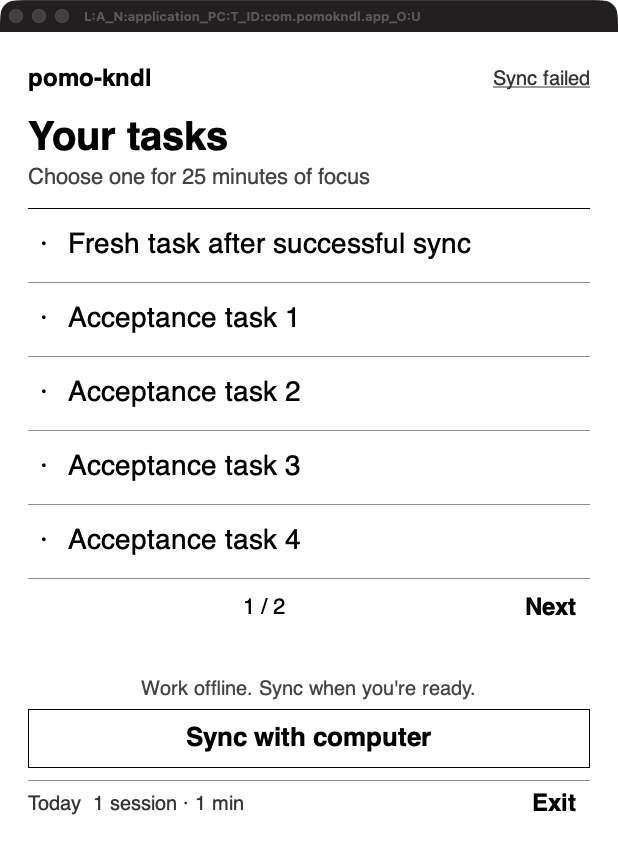

# UI and connection acceptance recheck

Date: 24 October 2026. Changes: `e6bbfca`, `19f02f7`, `8a2baa2`.

## Interpretation and scope audit

The request was to tidy the UI and explain what is wrong with the current "design connection". UI cleanup is explicit. I inferred that "design connection" means the Kindle-to-computer sync design, based on the native GTK application, its networking code, and the previous project discussion. It could instead refer to visual coherence or an external design tool. The user has not explicitly confirmed the inferred meaning.

The initial, uncertain phase performed read-only repository, history, MCP-connection, and environment inspection. No UI or networking edits were made before identifying the project and stating the sync interpretation. The eventual changes preserve the existing monochrome Kindle design rather than introducing a web UI or unrelated design integration. The additional build/test-script changes address failures encountered while verifying the requested UI and connection work.

Subjective visual preference has not been approved by the user. The concrete improvements verified below are task reachability, successful startup refresh, visible failure state, and preservation of offline work.

## Real public-interface exercise

This pass did not use `POMO_KNDL_SCRIPT`, `POMO_KNDL_AUTO_SYNC`, manually constructed state JSON, copied application source, mock servers, or direct internal callbacks. It used the repository's built executables, the actual native macOS GTK window, the public CLI, and the real pinned-TLS server. Application data was isolated in a new scratch directory. No real user tasks or mounted Kindle files were changed.

1. Created eight tasks with `pomo-kndl --home <test-home> add`, then paired using `pair --host 127.0.0.1 --port 17429 --out <test-kindle>/pairing.json` and ran `serve --bind 127.0.0.1:17429`.
2. Launched `kindle/build/pomo-kndl-gui` normally with only `POMO_KNDL_DIR` and `POMO_KNDL_GEOMETRY=618x824`. Both script variables were explicitly unset. Without pressing Sync, the real CLI reported a landing carrying plan 8, and the Kindle saved all eight tasks with zero pending entries.
3. The native window showed page 1/2. Clicked the actual Next target, observed tasks 6, 7 and 8 on page 2/2, then clicked task 8. The visible screen changed to Focusing / Acceptance task 8 / 25 minutes. The persisted session had `phase=focus` and the matching task title. This is an observed improvement over the original seven-task cutoff, which had no navigation to later carried tasks.
4. Stopped only the isolated test server. A subsequent attempted native Pause click did not change state after the user's active application took focus. GTK did not expose usable Accessibility controls on this Mac. To avoid further interference with the live desktop, stopped native pointer testing and closed only the test GUI. Do not count that attempted click as a successful native Pause test.
5. Continued through the shipped public headless client: `pause`, `end`, `done`, and `sync`. The timer recorded 92 seconds of focus and completion of task 8. With the server unavailable, sync returned `computer unreachable at 127.0.0.1:17429`. SHA-256 of the saved state was identical before and after this failed sync. Both the session and completion entries remained pending, and task 8 remained crossed off locally.
6. Restarted the isolated real server and ran the public client `sync`. It returned `landed: plan 9, 0 pending`. The computer's public `tasks` command showed task 8 completed, `history` showed one interrupted session with one whole focus minute, and `status` showed acknowledgement through sequence 2 and nothing to review.
7. Added a new task through the public CLI after that successful landing and moved it to the top. An initial ID-extraction command supplied an invalid prefix and was rejected without applying the move; using the actual returned task ID succeeded. The Kindle still had plan 9, a recorded successful sync and an empty outgoing log before relaunch.
8. Relaunched the actual GUI normally, again with both script variables unset. Without a manual Sync, it fetched plan 11 and displayed **Fresh task after successful sync** as the first task. This directly exercises the startup condition that the original implementation skipped.
9. Stopped the isolated server and relaunched the normal GUI again. The actual window showed **Sync failed**, retained all eight carried tasks and kept the Sync control available. Its saved plan remained 11. This demonstrates a usable offline screen rather than a false current-success indication after a failed attempt.

Native-window evidence, captured from the real application rather than its screenshot hook:

The earlier GTK scripted suite remains complementary evidence for keyboard callbacks, malformed-pairing retries, long-title layout, session transitions and connection-detail navigation. It passed at 618x824 and 1236x1648. It is not being relabeled as a physical-device test. The network suite, real Rust/C++ end-to-end suite, and ARM VM sync tests also passed.

## Current real connection observation

At the first inspection, the mounted Kindle's host matched the Mac's current LAN IP, a real server was listening on port 7419, and an intentionally unauthenticated request passed the pinned TLS check before receiving the expected auth rejection.

A later read-only check at **2026-10-24 21:56:58 UTC** found **no listener on port 7419**, and the previously observed server PID was no longer present. The reason it stopped was not established. All server-start/stop commands in the acceptance exercise targeted the isolated server on port 17429, not the user's real server. The real server was not restarted, because it may have been intentionally stopped. Under the current architecture, LAN sync cannot succeed without `pomo-kndl serve` running on the paired computer.

## Remaining acceptance boundary

- The physical Kindle was mounted over USB. The rebuilt application was not installed or launched on it. No physical e-ink refresh, touch, suspend/resume, or Kindle-origin Wi-Fi acceptance result is available.
- The ARM VM verifies executable startup and TLS interoperability, not the Kindle's actual screen or Wi-Fi environment.
- Background native GTK control was unavailable through macOS Accessibility. Once the user's desktop activity interrupted pointer testing, the rest of the session flow was verified through the public client instead of competing for focus.
- All test-only GUI/server processes were stopped. The user's active application was left undisturbed at cleanup. The device's installed application, pairing and task state were not changed.

The host application and real integration boundaries have concrete passing observations. Physical-device acceptance and the user's aesthetic approval remain unverified, so the overall feedback loop is representative, not closed end-to-end on the target device.
